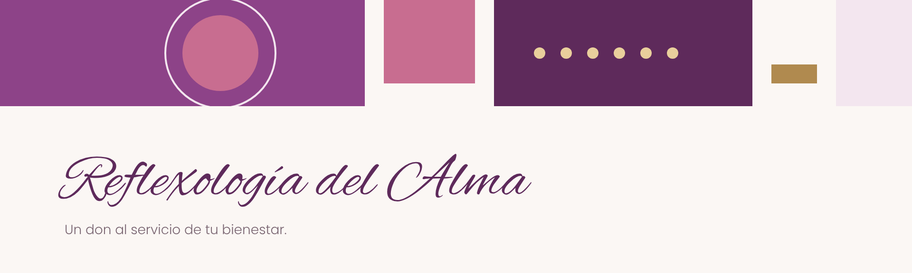
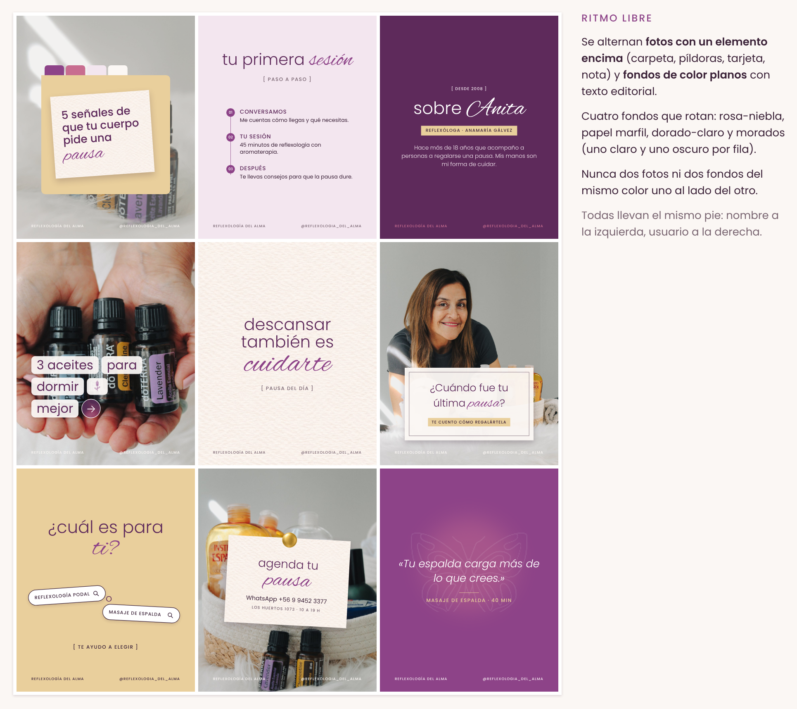
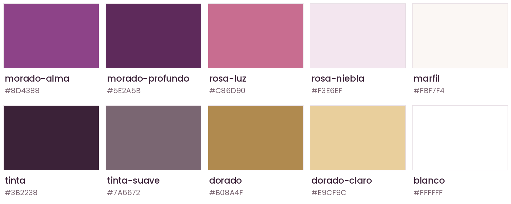

# Reflexología del Alma — Libro de marca

> *Un don al servicio de tu bienestar.*

Este libro reúne todo lo necesario para crear la grilla, los posteos y las historias de Reflexología del Alma. Está ordenado igual que una carpeta de marca: primero **quién es** y **cómo se ve**, luego **cómo habla**, **qué ofrece** y **cómo se publica**.

## Índice

| Carpeta | Sección | Para qué sirve |
| --- | --- | --- |
| **marca** | [Identidad visual](marca/identidad.md) | Logo, colores, tipografías, elementos gráficos y fotografía. |
| | [Ilustraciones](marca/ilustraciones.md) | El set de dibujos de línea fina y cómo crear nuevos. |
| **narrativa** | [Qué es Reflexología del Alma](narrativa/que-es-reflexologia-del-alma.md) | Historia, propósito, valores, público y biografía de Anita. |
| | [Qué se puede decir](narrativa/que-se-puede-decir.md) | Lo que sí y lo que no se dice sobre salud, fe, clientas y precios. |
| | [Tono de voz](narrativa/tono-de-voz.md) | Cómo escribe la marca, frases, etiquetas y ejemplos. |
| **oferta** | [Servicios](oferta/servicios.md) | Servicios, duración, valores y cómo presentarlos. |
| **redes** | [Grilla y formatos](redes/grilla-y-formatos.md) | Pilares de contenido, ritmo de la grilla, medidas y lista de control. |
| **referentes** | [Estilo visual](referentes/estilo-visual.md) | Las imágenes de inspiración y qué tomar de cada una. |
| **plantillas** | [Vistas previas](plantillas/README.md) | Cómo se ve cada tipo de publicación. |
| **assets** | [Logo](assets/logo) · [Fotos](assets/fotos) · [Ilustraciones](assets/ilustraciones) · [Texturas](assets/texturas) | Archivos para descargar y usar en Canva. |

## Vista previa de la grilla

## Colores

Tipografías: **Poppins** (títulos y textos) y **Alex Brush** (palabras de acento en cursiva). Detalle completo en [Identidad visual](marca/identidad.md).

## En una frase

Reflexología del Alma es el espacio de Anamaría Gálvez (Anita), reflexóloga desde 2008, donde la reflexología podal, el masaje de espalda y la auriculoterapia, siempre acompañados de aromaterapia, se ofrecen con cariño y experiencia para el bienestar de las personas. Su fe la inspira y se nota en los detalles, pero la cuenta habla de bienestar.

## Cómo usar este libro para diseñar

1. Elegir el pilar de contenido y el formato en **Grilla y formatos**.
2. Ubicar la pieza en el ritmo de la grilla (qué fondo le toca).
3. Copiar la [plantilla](plantillas/README.md) correspondiente y respetar márgenes (`margen-lateral` 90 px) y estilos de texto.
4. Redactar con **Tono de voz** y revisar **Qué se puede decir**: español de Chile, de tú, sin palabras en inglés, sin promesas de sanación.
5. Pasar la lista de control antes de publicar.

## Ficha rápida

| | |
| --- | --- |
| **Instagram** | @reflexologia_del_alma |
| **Reflexóloga** | Anamaría Gálvez (Anita) |
| **Dónde** | Los Huertos 1073, Peñuelas · Jaz Studio y Academia |
| **Horario** | 10:00 a 19:00 h |
| **Agenda** | WhatsApp +56 9 9452 3377 |
| **Público** | 25 a más de 60 años |

## Datos por confirmar

- Días de atención (el horario es de 10:00 a 19:00 h).
- Más fotos de Anita trabajando (pies y espalda) para los posteos de servicios.
- Cuentas de Instagram que Anita admire (para sumar a **Referentes**).
- Corrección de la tilde en el logo («Reflexologia» → «Reflexología»).
