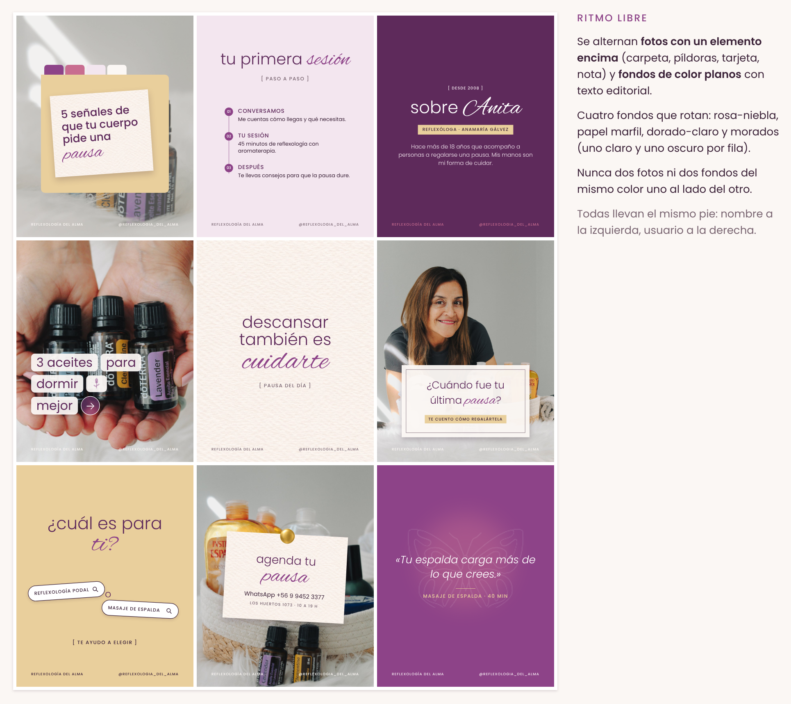
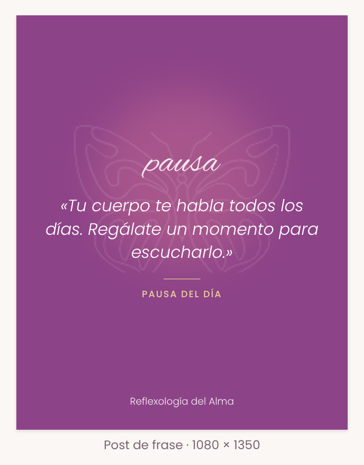
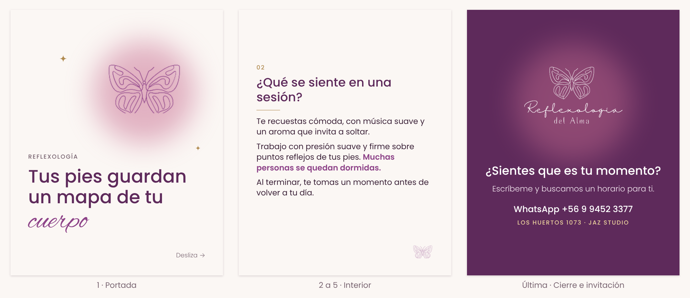
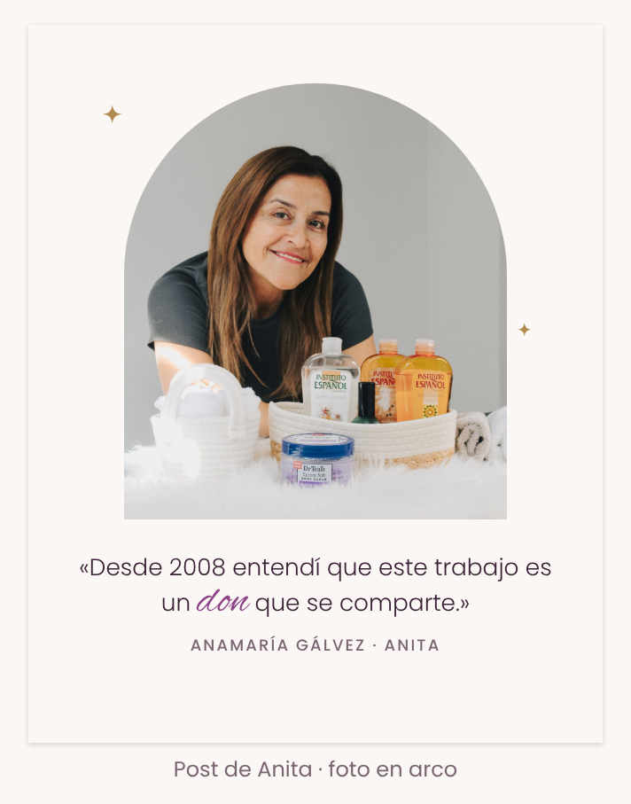
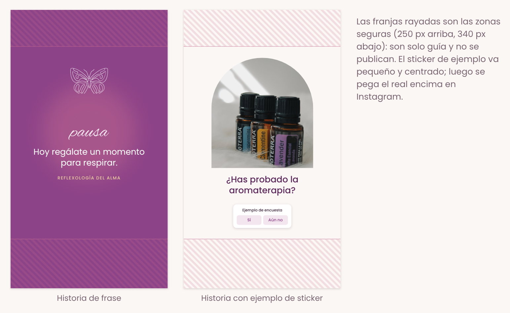
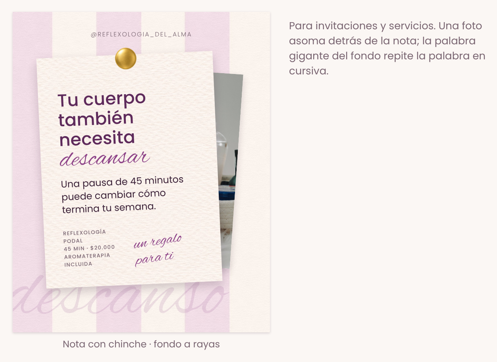
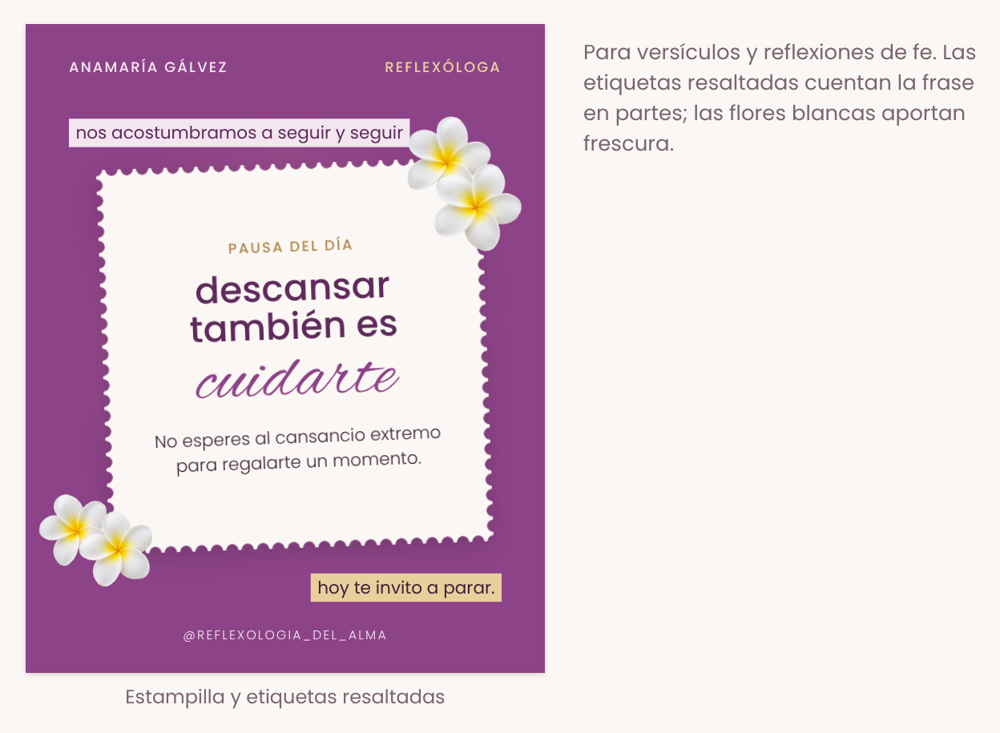
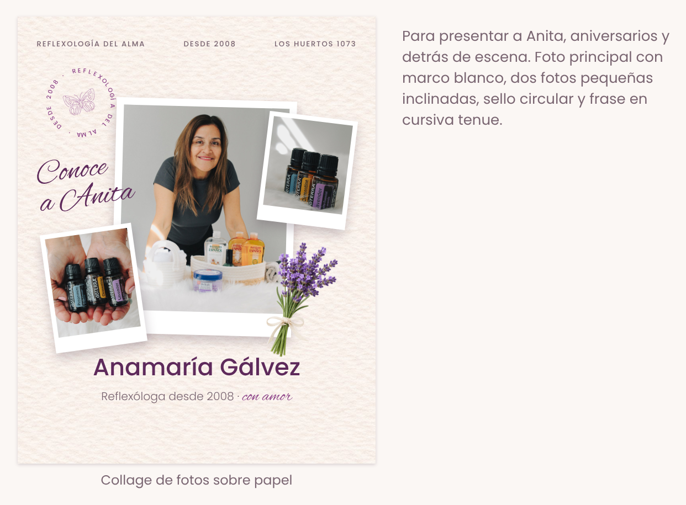
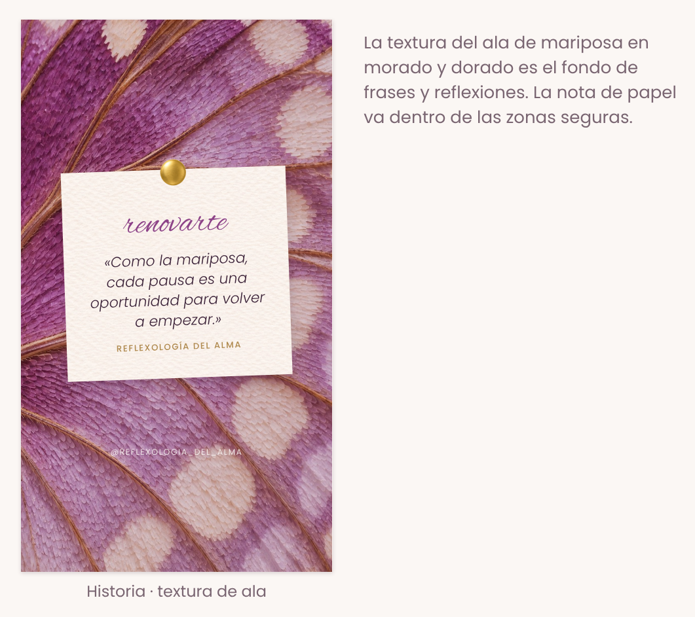
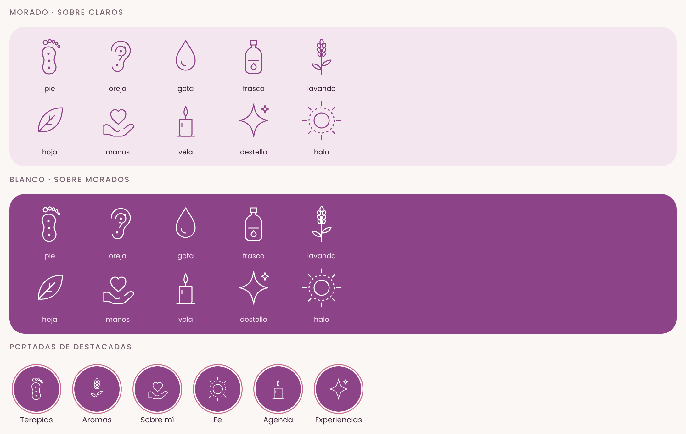

# Plantillas

Vistas previas de cada plantilla con sus reglas. Los textos de ejemplo se reemplazan por el contenido de cada publicación.

**Estilo plano:** Grilla, Post de frase, Carrusel educativo, Post de Anita, Historia.
**Estilo editorial:** Post nota, Post estampilla, Post collage, Historia ala.

---

## Grilla

Ritmo libre y editorial: se alternan fotos reales con un elemento encima y fondos de color planos con texto grande, sin repetir tipo ni color lado a lado.

- Fotos con: carpeta con pestañas, píldoras de texto, tarjeta enmarcada o nota con chinche.
- Fondos planos: `rosa-niebla`, papel marfil, `dorado-claro`, `morado-alma` o `morado-profundo`, con una palabra en `acento-script`.
- En cada fila, al menos una foto y un fondo morado o dorado.
- Mismo pie en todas: «Reflexología del Alma» a la izquierda, usuario a la derecha.
- Planificar de a una fila (3 publicaciones por semana).

---

## Post de frase

Una sola lámina sobre `morado-alma` con una frase propia de bienestar, centrada; es la pieza del pilar Pausa y bienestar.

- Arriba, una palabra en `acento-script` color `rosa-niebla` (pausa, calma, respira).
- Frase en estilo `versiculo` (Poppins 300 cursiva, 48–54 px), blanca, centrada, máximo 5 líneas. Usar las frases de **Tono de voz**.
- Línea fina `dorado-claro` de 120 px y «Pausa del día» en `etiqueta` `dorado-claro`.
- Detrás: halo `rosa-luz` difuso y el isotipo blanco al 10 % como marca de agua.
- Ocasionalmente (máximo una vez al mes) puede llevar un versículo con su referencia en lugar de la frase.

---

## Carrusel educativo

Carrusel de 5 a 7 láminas sobre fondo `marfil` que explica una terapia; es la pieza del pilar Conoce tus terapias.

- **Portada:** `etiqueta` con el nombre de la terapia, título en `portada-titulo` color `morado-profundo` y la última palabra en `acento-script` color `morado-alma`. Isotipo con halo arriba a la derecha. «Desliza →» en `auxiliar`.
- **Interiores:** número en `etiqueta` `dorado`, título en `titulo-interior`, línea dorada de 120 px, desarrollo en `texto-lectura` (máximo 3 párrafos cortos, 20 px entre ellos). Negrita en `morado-alma` para una sola idea. Isotipo pequeño abajo a la derecha.
- **Cierre:** fondo `morado-profundo`, logo blanco con halo, pregunta de invitación y lugar de atención.
- Una idea por lámina; si no cabe, agregar otra lámina en vez de achicar la letra.

---

## Post de Anita

Foto de Anita, de sus manos o de su espacio en forma de arco (`radio-arco`) sobre `marfil`, con una frase corta suya debajo; es la pieza del pilar Anita y su camino.

- Foto de 720 × 820 px centrada, esquinas superiores redondeadas a la mitad del ancho.
- Frase en Poppins 300, 44 px, centrada, con una palabra clave en `acento-script` `morado-alma`.
- Su nombre en `etiqueta` `tinta-suave`.
- Uno o dos destellos dorados como máximo.
- Usa las fotos reales de la sección **Fotos** (por ejemplo `anita-sonriendo.jpg`).

---

## Historia

Historia de 1080 × 1920 con una sola idea, sobre `morado-alma` o `marfil`, respetando las zonas seguras de Instagram.

- Nada importante en los 250 px de arriba (`historia-zona-superior`) ni en los 340 px de abajo (`historia-zona-inferior`).
- Para encuestas, preguntas o enlaces: incluir un ejemplo del sticker muy pequeño y centrado, sin tapar a nadie; luego se pega el sticker real encima.
- Las franjas rayadas de la vista previa son solo guía: no se exportan.
- Portadas de destacadas: fondo `morado-alma` con isotipo blanco al centro.

---

## Post nota

Una nota de papel marfil con chinche dorado sobre el fondo a rayas, con una foto que asoma detrás; para invitaciones, servicios y frases.

- Fondo: `fondo-rayas.jpg`. Palabra gigante en Alex Brush al 13 % de opacidad en la parte de abajo, la misma palabra de la cursiva del título.
- Nota: `textura-papel.jpg`, inclinada −2 a −3°, sombra `papel`, chinche (`chinche-dorado.png`) al centro arriba.
- Título en Poppins 500 (70–76 px) con una palabra en `acento-script`; bajada en `texto-lectura`.
- Abajo, dos columnas: texto pequeño en mayúsculas justificado (datos) y una frase corta en cursiva inclinada.
- Usuario arriba en `etiqueta`.

---

## Post estampilla

Un marco de estampilla dentado sobre `morado-alma`, con etiquetas de texto resaltado y flores blancas; para frases de bienestar y reflexiones.

- Estampilla marfil inclinada −2°, con «Pausa del día» en `etiqueta` dorado, la frase en Poppins 500 y la palabra clave en `acento-script`.
- Etiquetas resaltadas: frases cortas con fondo `rosa-niebla` o `dorado-claro`, una arriba a la izquierda y una abajo a la derecha, que «cuentan» la frase en partes.
- Flores blancas recortadas (`flores-blancas.png`) en dos esquinas opuestas, sin tapar el texto.
- Arriba: nombre de Anita y «Reflexóloga» en `etiqueta`. Abajo: usuario.

---

## Post collage

Collage de fotos con marco blanco sobre papel texturado, con sello circular y frase en cursiva; para presentar a Anita, aniversarios y detrás de escena.

- Fondo: `textura-papel.jpg`. Arriba, tres datos en `etiqueta` repartidos a lo ancho.
- Foto principal grande con marco blanco (tipo instantánea), levemente inclinada; dos fotos pequeñas inclinadas en lados opuestos.
- Sello circular con texto «Reflexología del Alma · desde 2008» y la mariposa al centro.
- Frase en `acento-script` grande a un costado y un ramo de lavanda (`ramo-lavanda.png`) como detalle.
- Abajo: nombre en Poppins 500 y una línea auxiliar.
- Necesita fotos reales de Anita.

---

## Historia ala

Historia con la textura del ala de mariposa (morado y dorado) de fondo y una nota de papel con chinche; para frases de bienestar y reflexiones (y, de vez en cuando, un versículo).

- Fondo: `textura-ala-mariposa.jpg` con un velo `morado-profundo` al 18 %.
- Nota de papel inclinada −2°, con palabra en `acento-script`, frase en `versiculo` y firma en `etiqueta` dorado.
- La nota y el usuario van siempre dentro de las zonas seguras (250 px arriba, 340 px abajo).

---

## Ilustraciones

El set de dibujos de línea fina en morado y blanco, y cómo se ven como portadas de destacadas.

- Una ilustración por lámina (dos si son pequeñas), entre 90 y 320 px en un posteo de 1080 px.
- Morado sobre `marfil` y `rosa-niebla`; blanco sobre `morado-alma` y `morado-profundo`.
- Destacadas: fondo `morado-alma`, ilustración blanca al centro.
- Reglas completas y cómo crear nuevas: sección Ilustraciones.

