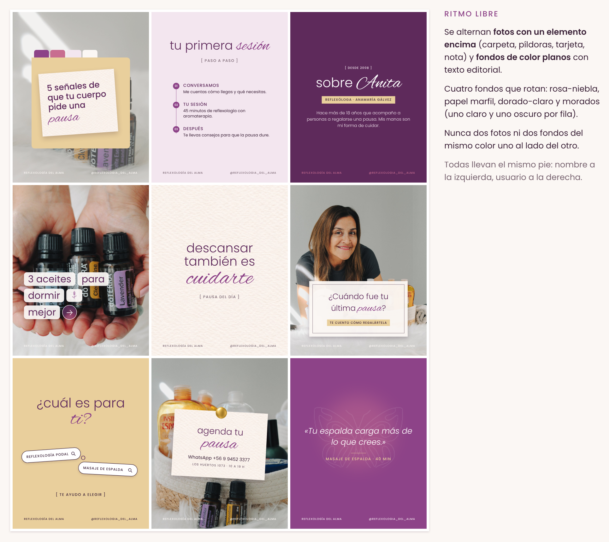

# Grilla y formatos

## Pilares de contenido

| Pilar | Peso | Qué se publica | Formato preferido |
| --- | --- | --- | --- |
| **1. Pausa y bienestar** | 25 % | Frases propias de bienestar, invitaciones a descansar, reflexiones breves. Aquí cabe, de vez en cuando, un toque de fe (máximo un versículo al mes). | Post de frase (fondo morado), estampilla, historia de ala. |
| **2. Conoce tus terapias** | 35 % | Qué es cada terapia, para quién es, qué esperar, mitos y verdades, aceites y sus aromas. | Carrusel educativo (fondo claro). |
| **3. Anita y su camino** | 20 % | Su historia desde 2008, por qué hace esto, detrás de escena, sus manos trabajando. | Post con foto en arco, video corto. |
| **4. Invitación** | 20 % | Dónde atiende, cómo reservar, experiencias de clientas (con permiso), fechas especiales. | Post de invitación, historias con sticker. |

**Ideas por terapia (para carruseles)**
- *Reflexología:* qué son los puntos reflejos · qué se siente en una sesión · cada cuánto ir · mitos y verdades.
- *Aromaterapia (incluida en cada sesión):* tres aceites para descansar · cómo los uso en tu sesión · lavanda para dormir mejor.
- *Masaje de espalda:* señales de que tu espalda pide una pausa · cómo prepararte para tu masaje.
- *Auriculoterapia (complemento de $8.000):* qué es · cómo se trabaja en la oreja · por qué sumarla a tu sesión.

**Fechas especiales:** Día de la Madre, Día del Padre, Navidad (tarjetas de regalo), aniversario de la marca. En Navidad y Semana Santa cabe un saludo con un toque de fe.

## Ritmo de la grilla (ritmo libre)

La grilla no sigue un patrón fijo de cuadros: busca un ritmo **editorial y variado**, donde cada publicación se ve distinta a la de al lado pero todas se sienten de la misma familia. Ver la [vista previa de la grilla](../plantillas/README.md#grilla).

**Dos tipos de pieza que se alternan:**
1. **Foto con un elemento encima:** una foto real de fondo (Anita, sus manos, sus productos) con algo apoyado sobre ella: carpeta con pestañas, nota con chinche, píldoras de texto o tarjeta enmarcada.
2. **Fondo de color plano:** texto editorial grande con una palabra en cursiva, y a veces un recurso gráfico (línea de tiempo, barras de búsqueda, etiqueta resaltada).

**Cuatro fondos que rotan:** `rosa-niebla`, papel marfil (`textura-papel.jpg`), `dorado-claro` y morados (`morado-alma` o `morado-profundo`).

**Reglas:**
- Nunca dos fotos ni dos fondos del mismo color uno al lado del otro.
- En cada fila de tres, al menos una foto y un fondo morado o dorado.
- Todas las publicaciones llevan el mismo pie: «Reflexología del Alma» a la izquierda y «@reflexologia_del_alma» a la derecha, en `etiqueta` pequeña.
- Los subtítulos van entre corchetes: «[ paso a paso ]», «[ pausa del día ]».

**Ejemplo de 9 publicaciones:**

| | Columna 1 | Columna 2 | Columna 3 |
| --- | --- | --- | --- |
| Fila 1 | Foto + carpeta: «5 señales de que tu cuerpo pide una pausa» | Rosa-niebla: «tu primera sesión» con línea de tiempo | Morado profundo: «sobre Anita» |
| Fila 2 | Foto + píldoras: «3 aceites para dormir mejor» | Papel: «descansar también es cuidarte» | Foto + tarjeta: «¿Cuándo fue tu última pausa?» |
| Fila 3 | Dorado: «¿cuál es para ti?» con barras de búsqueda | Foto + nota: «agenda tu pausa» | Morado: frase del masaje de espalda |

Instagram muestra lo más nuevo arriba a la izquierda: planificar de a una fila y publicar en orden columna 3, columna 2, columna 1.

**Piezas editoriales** (Post nota, Post estampilla, Post collage): úsalas como piezas destacadas, respetando que no queden dos del mismo fondo juntas.

**Frecuencia sugerida:** 3 publicaciones por semana (una fila) + 3 a 5 historias.

## Formatos y medidas

| Formato | Medida | Notas |
| --- | --- | --- |
| Post y carrusel | 1080 × 1350 px | Márgenes laterales 90 px. Lo importante dentro del recorte central que muestra la grilla. |
| Historia y video corto | 1080 × 1920 px | Nada importante en los 250 px de arriba ni en los 340 px de abajo. |
| Portada de video corto | 1080 × 1920 px | Título dentro del cuadrado central de 1080 × 1080. |
| Destacadas | 1080 × 1920 px | Fondo `morado-alma` con ilustración blanca al centro (ver **Ilustraciones**). |

## Estructura de cada pieza

**Post de frase (una lámina).** Fondo morado-alma · isotipo tenue como marca de agua · palabra en cursiva · frase propia centrada en `versiculo` · «Pausa del día» en `etiqueta` dorado-claro · firma abajo. Ocasionalmente (máximo una vez al mes) puede llevar un versículo.

**Carrusel educativo (5 a 7 láminas).**
1. Portada: título en `portada-titulo` + una palabra en `acento-script`, halo detrás, «desliza» en `auxiliar`.
2. a 5. Una idea por lámina: número en `etiqueta`, título en `titulo-interior`, desarrollo en `texto-lectura` (máximo 3 párrafos cortos). Puede llevar una ilustración pequeña.
6. Reflexión breve de bienestar (opcional) que conecte el tema con la vida diaria.
7. Cierre en morado-profundo: invitación suave a agendar + logo blanco.

**Post de Anita.** Foto en arco sobre marfil · frase corta suya debajo · firma.

**Historia.** Una sola idea, fondo marfil o morado. Si lleva sticker (encuesta, pregunta, enlace), incluir un **ejemplo del sticker muy pequeño, centrado y sin tapar a nadie**, para luego pegar el real encima en Instagram.

## Lista de control antes de publicar

- [ ] ¿La pieza respeta el color que le toca en la grilla?
- [ ] ¿Usa solo Poppins y Alex Brush?
- [ ] ¿Una sola idea principal por lámina, sin huecos en blanco entre título y texto?
- [ ] ¿Negrita solo en una idea por párrafo?
- [ ] ¿Márgenes de 90 px y zonas seguras en historias?
- [ ] ¿Todo el texto en español, sin palabras en inglés?
- [ ] ¿Sin promesas de sanación (ver **Qué se puede decir**)?
- [ ] ¿La fe aparece solo como toque? (máximo un versículo al mes)
- [ ] ¿Dice cómo agendar (WhatsApp +56 9 9452 3377) cuando invita?
- [ ] ¿«Reflexología» con tilde?
- [ ] ¿El tono es una invitación tranquila, sin urgencia?
